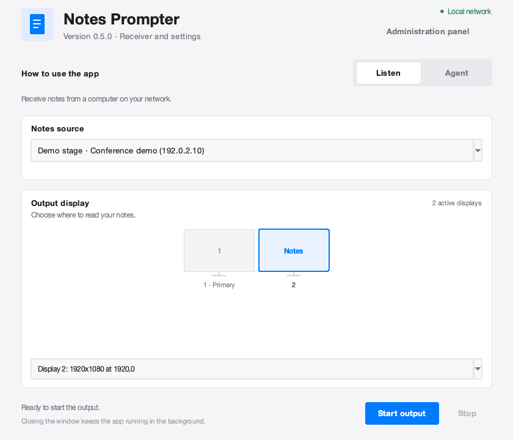
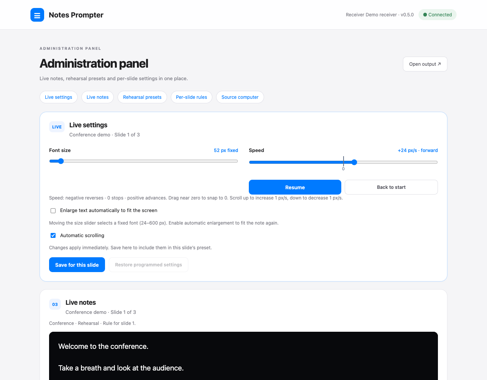
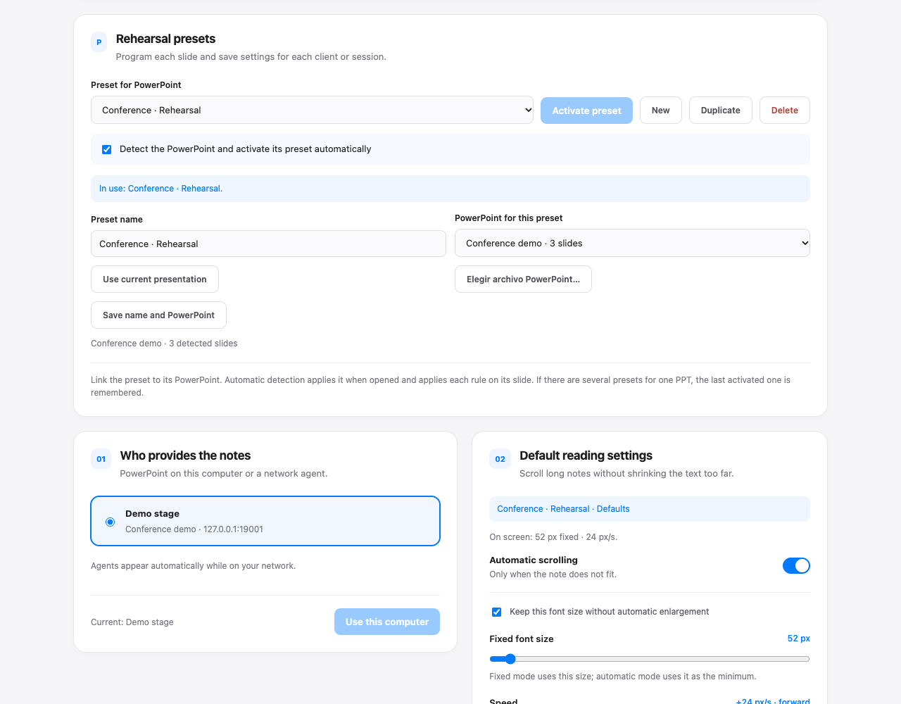
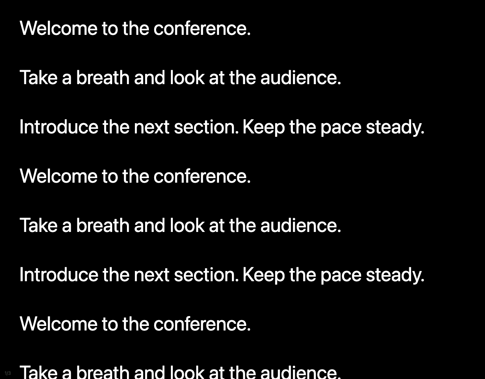
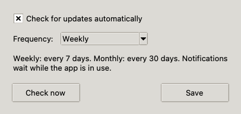

# Notes Prompter

## Downloads

[Download installers and portable Windows EXE](https://github.com/mentirosodiyei/notes-prompter/releases/latest) · [User guide (Spanish PDF)](docs/Guia-Usuario-0.5.1.pdf) · [Report a test](docs/INFORME-PRUEBAS.md). See [validation and known limitations](docs/RELEASE-0.5.1.md). The optional [Companion 5.1.1 module](companion-module/README.md) is included as source and as a separate release asset.

**Live PowerPoint speaker notes on an extended display, with per-presentation and per-slide reading settings.**

[Castellano](docs/README.es.md) · [Català](docs/README.ca.md) · [Build and test](docs/BUILD.md) · [Security](SECURITY.md)

Notes Prompter connects the computer running PowerPoint to the computer showing the prompter. It reads the current speaker notes without modifying or saving the presentation. Windows and macOS computers can be mixed on the same trusted local network.

## Two roles

| Role | What it does | Where to run it |
| --- | --- | --- |
| **Agent** | Reads the local PowerPoint slide and notes and announces the source on the LAN. It opens no browser, output or administration panel. | The computer running PowerPoint. |
| **Listen** | Selects an agent, applies its own presets and displays notes on the chosen monitor. Its **Administration panel** controls reading and presets. | The prompter/operator computer. |

On macOS, output uses an integrated WebKit window. On Windows, output uses Chrome or Edge. Opening the administration panel uses the default browser. The receiver does not need PowerPoint installed; a local Agent does.

## Quick start

1. On the PowerPoint computer, open the presentation, choose **Agent → PowerPoint on this computer → Start agent**. On macOS, allow Automation access to Microsoft PowerPoint when requested.
2. On the prompter computer, choose **Listen**, select the discovered agent and output display, then **Start output**.
3. Open **Administration panel** on the receiver to edit settings and presets. You can prepare presets before starting an output.
4. Close the application using **Application → Quit**. Closing its window keeps it in the background.

### 1. Select the source and display



**Listen/Agent** chooses the role. **Notes source** chooses the sender. **Output display** chooses the prompter monitor. The administration button is available only in Listen mode. This is the actual macOS interface with synthetic devices.

### 2. Control reading from the panel



- **Font:** fixed size from 24–600 px, or automatic enlargement with a minimum size.
- **Speed:** −200 to +200 px/s. Negative reverses, zero stops, positive advances. Drag near zero to snap there; wheel and arrow keys retain precise one-unit steps.
- **Pause/Resume** preserves the selected speed. **Back to start** preserves pause and speed. Both buttons stay in the panel, off the extended output.
- Live adjustments are temporary until the slide/source changes. **Save for this slide** writes them into the matching active preset.

### 3. Bind a preset to its PowerPoint and slides



Create a programme/preset for each presentation and put its slide rules inside it. For example, **6 PPTs × 25 slide rules = 150 independent settings**. Enable automatic detection to apply each presentation's programme and each slide's rule. Slides without a rule use that programme's defaults. Alternative programmes can be stored for one PPT; the preferred variant is remembered per presentation.

Identification uses the **file name without its extension, case-insensitively, plus the slide number**. Different decks must have distinct names. Review rules after reordering slides; bindings are not based on a content hash or persistent PowerPoint SlideID.

Existing limits are 200 presets and up to 2,000 rules per preset. Tests cover 150 settings across six presentations after settings reload, 150 separately stored presets, and a browser scenario with 150 presets. These are synthetic capacity tests, not a promise of network timing on every machine.

### 4. Show only the notes on the output



This is a browser capture of the actual output renderer using demo text, not a photograph of a physical extended monitor. Long notes scroll; short notes fit the screen. Every new slide starts at the top. A negative initial speed waits at the top until a forward speed is selected.

## Automatic language

| Operating-system UI language | Application and receiver panel |
| --- | --- |
| Catalan, including regional variants | Catalan |
| Spanish, including regional variants | Spanish |
| Any other language | English |

The app reads macOS preferred languages or Windows' user UI language. The browser's language does not override the receiver's language. Restart the app after changing the OS language. Speaker notes, presentation names and user-entered preset names are **never translated**.

## Platforms and installation

- **macOS 11+**: separate `arm64` (Apple Silicon) and `x86_64` (Intel) packages. Python is included in packaged apps. Local builds have an ad-hoc signature, not Developer ID notarization.
- **Windows 10/11 x64**: a PyInstaller executable and an Inno Setup installer can be built with the supplied scripts.
- This repository is source code. It does not contain installers or a bundled Python runtime. See [build instructions](docs/BUILD.md). Published binaries, if provided, belong in GitHub Releases, not in the source tree.

The receiver's settings are stored in the user's application-data folder and survive updates. Invalid settings files are preserved and writes are blocked until a valid backup is restored. Back up settings before upgrading; they may contain private presentation and preset names.

## Bitfocus Companion

The separate Notes Prompter: Master module **1.0.3** uses the receiver's HTTP API. Connect it to the **Listen receiver's IP**, port **8765**. Existing source selection, font/speed knobs, negative/zero speed and live-save/reset actions remain compatible. The separate module is not bundled in this source repository. The new panel Pause/Resume/Back to start controls are not actions in module 1.0.3.

## Network and privacy

Discovery uses UDP **8766**; HTTP/WebSocket uses TCP **8765**. Discovery advertises the computer and presentation names; WebSocket carries speaker notes. There are no accounts or telemetry services. This version has **no authentication or transport encryption**: use a trusted, isolated LAN and do not expose it to the Internet. See [SECURITY.md](SECURITY.md).

All screenshots use generated notes and synthetic device names. This source package excludes personal settings, presentations, original task prompts, development logs, environments and build outputs. Re-run the privacy check before publishing new files.

## Development and validation

```sh
python -m venv .venv
# Activate .venv for your platform, then:
python -m pip install -e ".[dev,build]"
python -m pytest -q
node --test tests/browser/playback.test.cjs
python tools/privacy_audit.py
```

See [CONTRIBUTING.md](CONTRIBUTING.md) for translations, screenshot regeneration and tests, and [review notes](docs/REVIEW.md) for fixed issues and validation boundaries. PowerPoint/COM tests use substitutes; tests on macOS or under Rosetta do not establish Windows hardware compatibility. Physical PowerPoint, multiple displays, OS gestures and Windows installer execution still need release testing.

MIT license. See [LICENSE](LICENSE).

## Updates

From 0.5.1, **Application → Updates** lets you choose weekly (default, 7 days) or monthly (30 days), disable automatic checks, or check now. The last check is remembered across restarts. Checks use this repository's latest published release and the package matching the installed architecture. Notices wait until the agent/output stops and the main window is visible. Choose **Download and install**, **Not now**, or **Skip this version**. Manual checks can offer a skipped version again.

Downloads require HTTPS, matching size and GitHub's SHA256 digest. Mac apps also pass signature, bundle version, architecture and minimum OS checks. The app stages the update before quitting and restarts after installation, preserving presets/settings. Portable replacements keep the previous executable/app; Windows installations use the per-user installer with the same destination. No administrator escalation, quarantine removal or security-setting changes are performed. Read-only destinations report an error and keep the app open.

**0.5.0 has no updater:** install 0.5.1 manually once. Future published versions can then be installed from the app. Running from source does not self-update or perform automatic network checks.




Update checks contact GitHub over HTTPS and identify the app version; GitHub can see the client IP. Notes, settings and presets are never included in these requests.
