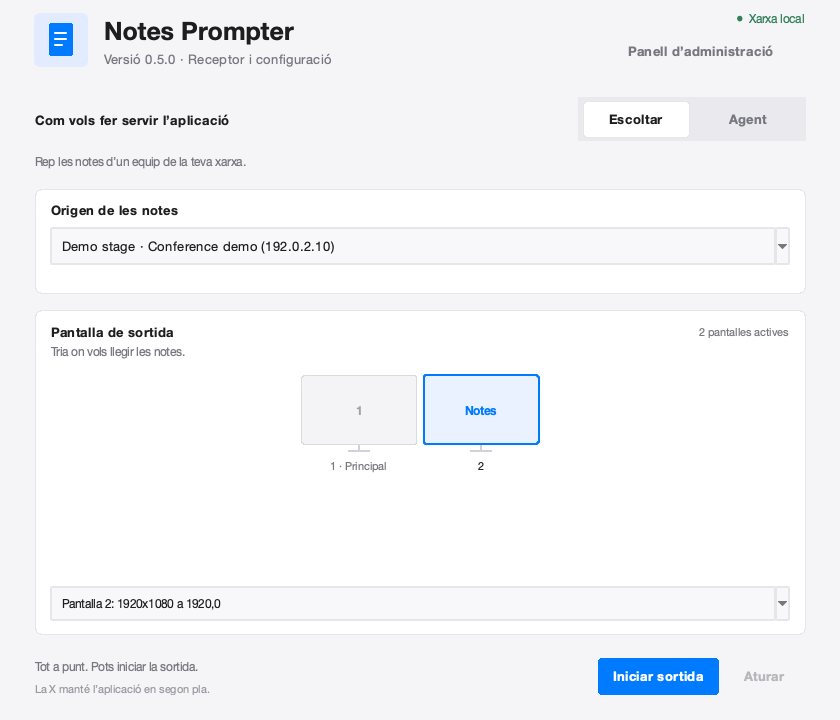
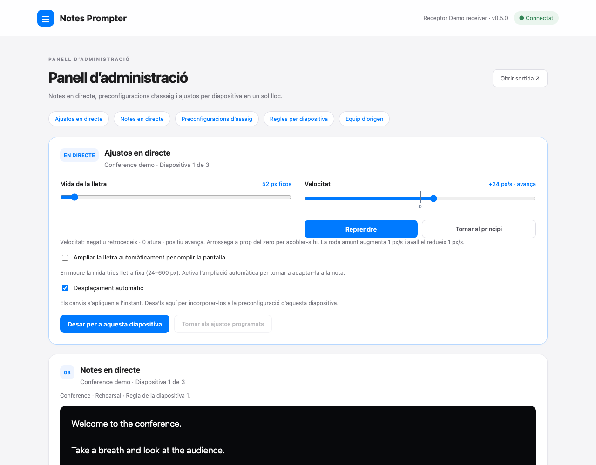
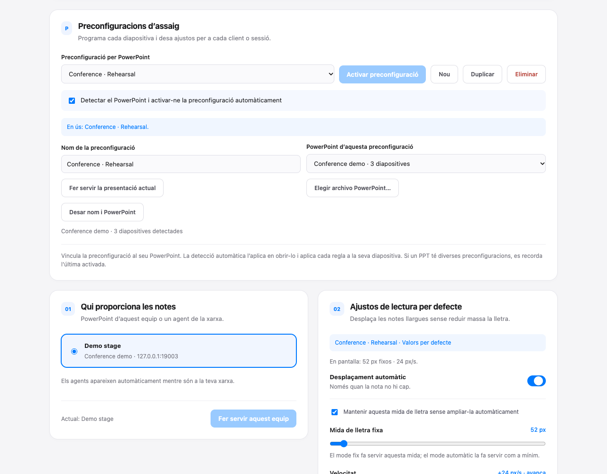
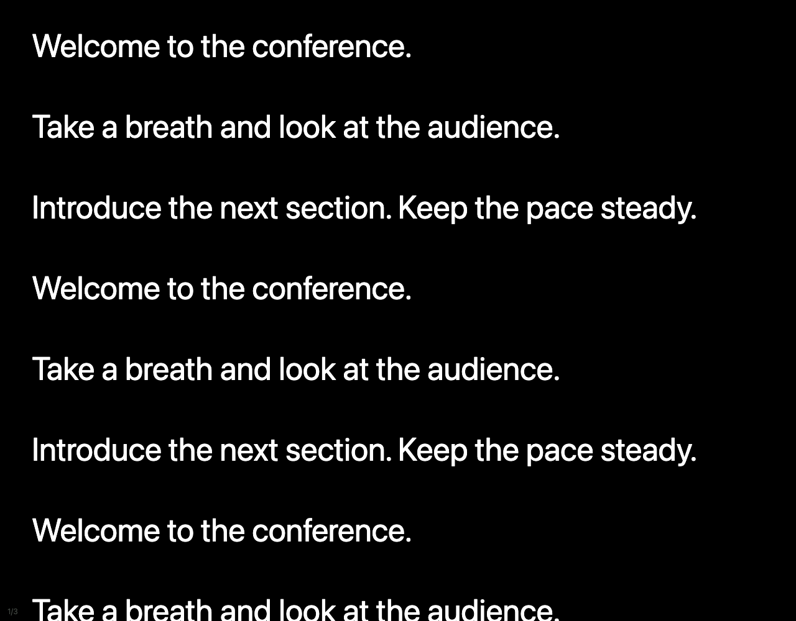

# Notes Prompter

## Descàrregues beta

[Instal·ladors i EXE portable](https://github.com/mentirosodiyei/notes-prompter/releases/tag/v0.5.0-beta.1) · [Guia per a beta testers (PDF en castellà)](Guia-Beta-Testers-0.5.0.pdf) · [Fitxa de proves](INFORME-BETA.md). Consulta [l’estat i les limitacions](RELEASE-0.5.0.md). Inclou el [mòdul Companion 5.1.1](../companion-module/README.md) com a codi i paquet separat.

**Notes del presentador de PowerPoint en una pantalla estesa, amb ajustos per presentació i diapositiva.**

[English](../README.md) · [Castellano](README.es.md) · [Compilació i proves](BUILD.md)

L’aplicació llegeix les notes i la diapositiva actuals sense modificar ni desar el PowerPoint. Pots combinar equips Windows i Mac a la mateixa xarxa local de confiança.

## Posada en marxa

1. A l’equip amb el PowerPoint obert: **Agent → PowerPoint d’aquest equip → Iniciar agent**. Al Mac, permet l’accés d’Automatització a Microsoft PowerPoint quan es demani.
2. A l’equip que mostra les notes: **Escoltar**, tria l’agent i la pantalla i prem **Iniciar sortida**.
3. En aquest receptor obre **Panell d’administració**. Hi trobaràs la lectura en directe, les preconfiguracions i les regles per diapositiva. L’Agent només envia notes i no obre navegador ni sortida.
4. Per tancar completament fes servir **Aplicació → Sortir**. La X manté l’aplicació en segon pla.

Tria qui proporciona les notes i a quin monitor vols veure-les. La sortida del Mac és una finestra WebKit integrada; al Windows utilitza Chrome o Edge. El receptor no necessita tenir PowerPoint instal·lat.

## Llegir i controlar

- Mida fixa de 24–600 px o ampliació automàtica amb un mínim llegible.
- Velocitat de −200 a +200 px/s: negatiu retrocedeix, zero atura i positiu avança.
- En arrossegar a prop del zero, el control s’acobla a 0. La roda i les fletxes mantenen passos d’1 per sortir del zero.
- **Pausar/Reprendre** i **Tornar al principi** són sota la velocitat, mai a la pantalla estesa. La pausa conserva la velocitat; tornar al principi conserva totes dues.
- Els ajustos en directe duren fins que canvia la diapositiva o l’origen. Desa’ls per incorporar-los a la regla de la diapositiva de la preconfiguració activa.

## Preconfiguracions per PPT i diapositiva

Crea una preconfiguració vinculada a cada PowerPoint i desa-hi les regles. **6 PPT amb 25 regles cadascun són 150 ajustos independents**. Amb detecció automàtica es trien el programa del PPT i la regla del número de diapositiva actual. Les diapositives sense regla fan servir els valors per defecte. Pots desar variants i es recorda la triada per a cada PPT.

La identificació utilitza el nom del fitxer sense extensió, sense distingir majúscules, i el número de diapositiva. Fes servir noms diferents per a PPT diferents i revisa les regles si reordenes les diapositives. Els límits són 200 preconfiguracions i 2.000 regles per preconfiguració; s’han provat 150 combinacions en sis presentacions i 150 preconfiguracions desades, amb dades sintètiques.

Aquesta és una captura del visor de sortida, no una fotografia d’un monitor físic. Cada diapositiva nova comença a dalt. Les notes curtes s’adapten a la pantalla; les llargues es poden desplaçar.

## Idiomes, requisits i privacitat

La interfície segueix l’idioma del sistema: **català → català; castellà → castellà; qualsevol altre → anglès**. El navegador utilitza l’idioma del receptor. Les notes i els noms que escrius no es tradueixen. Reinicia l’aplicació després de canviar l’idioma del sistema.

macOS 11 o posterior, amb paquets separats per a Intel i Apple Silicon. Windows 10/11 x64. L’Agent local necessita PowerPoint. El codi font no inclou instal·ladors: consulta [BUILD.md](BUILD.md). Els ajustos es conserven en actualitzar; si el fitxer està malmès, l’aplicació el preserva i bloqueja les escriptures fins que es restauri una còpia vàlida.

Companion 1.0.3 continua sent compatible per triar l’origen, ajustar lletra/velocitat i desar/restablir ajustos en directe. Es connecta a la IP del **receptor en Escoltar**, port 8765. Encara no inclou accions pròpies per als nous botons Pausar/Tornar al principi.

UDP 8766 descobreix agents i TCP 8765 transporta notes i configuració. La xarxa anuncia noms d’equips i presentacions i comparteix les notes. **No hi ha autenticació ni xifratge**: fes servir una LAN de confiança i no exposis el servei a Internet. No hi ha telemetria. Llegeix [SECURITY.md](../SECURITY.md).

Les captures només contenen dades fictícies. El paquet públic exclou ajustos, presentacions, historials, entorns i binaris locals. La validació automatitzada i sota Rosetta no substitueix una prova física del Windows, el PowerPoint i diversos monitors. Consulta [la revisió](REVIEW.md).
