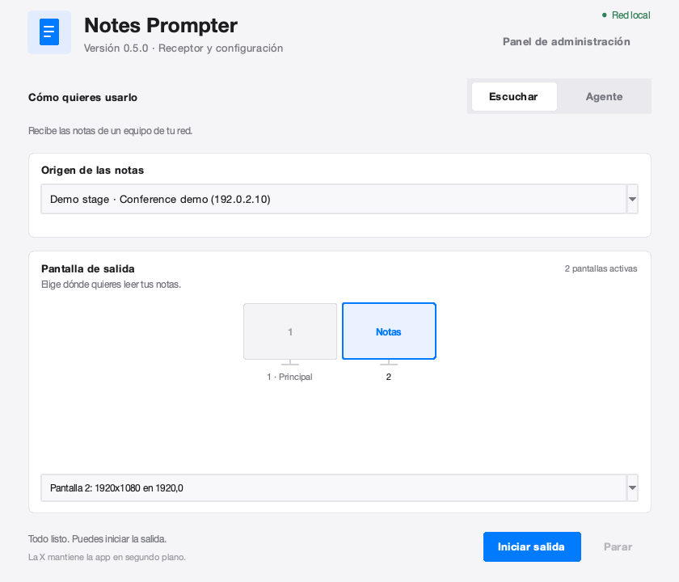
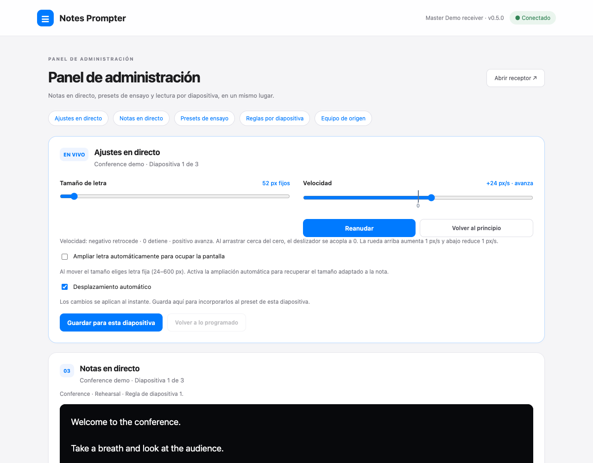
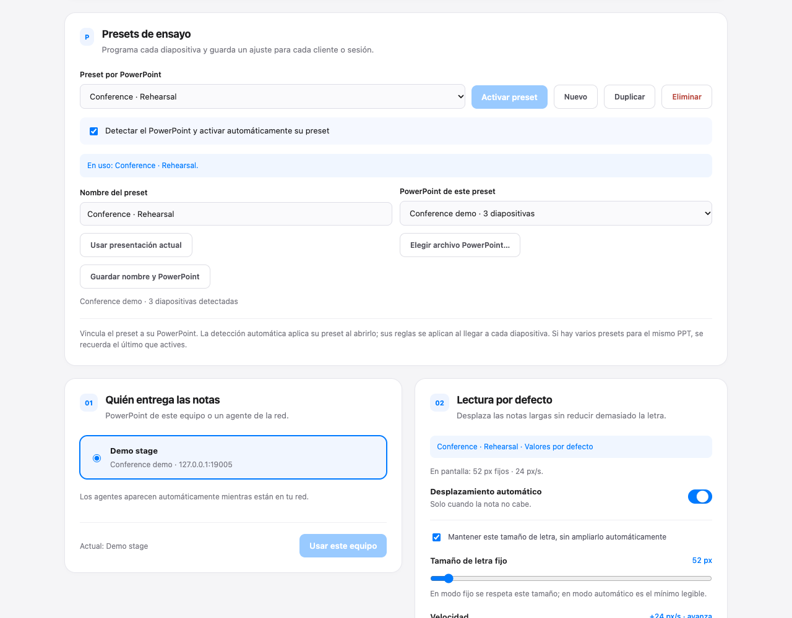
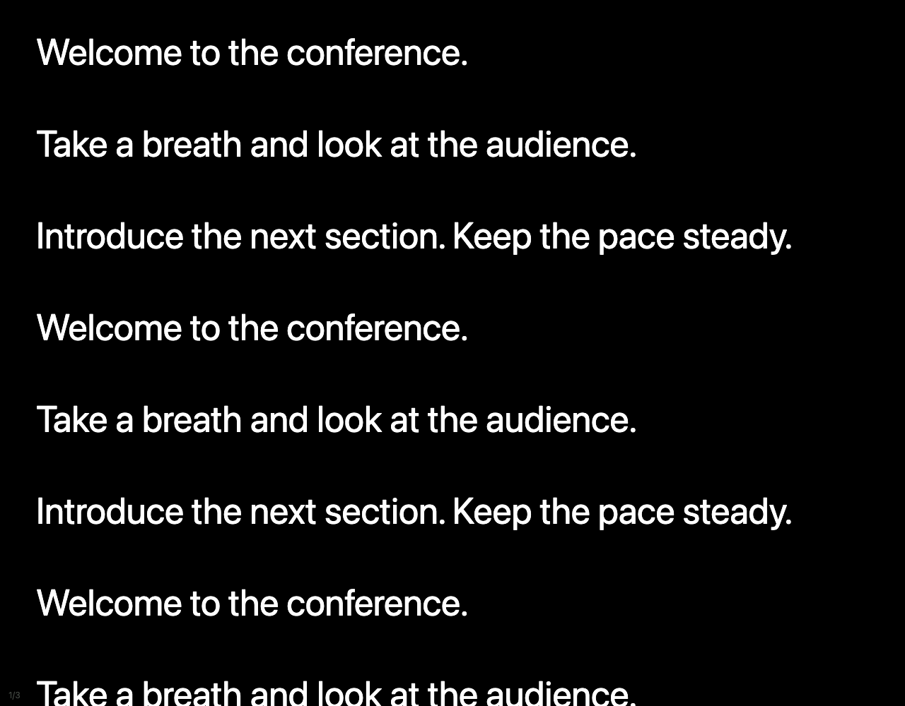
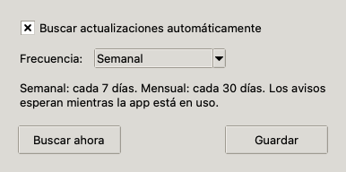

# Notes Prompter

## Descargas

[Instaladores y EXE portable](https://github.com/mentirosodiyei/notes-prompter/releases/latest) · [Guía de usuario (PDF)](Guia-Usuario-0.5.1.pdf) · [Ficha de pruebas](INFORME-PRUEBAS.md). Consulta el [estado y las limitaciones](RELEASE-0.5.1.md). Incluye el [módulo Companion 5.1.1](../companion-module/README.md) como código y paquete separado.

**Notas del orador de PowerPoint en una pantalla extendida, con ajustes por presentación y diapositiva.**

[English](../README.md) · [Català](README.ca.md) · [Compilación y pruebas](BUILD.md)

La app lee las notas y la diapositiva actuales sin modificar ni guardar el PowerPoint. Puedes combinar equipos Windows y Mac en la misma red local de confianza.

## Puesta en marcha

1. En el equipo con PowerPoint abierto: **Agente → PowerPoint de este equipo → Iniciar agente**. En Mac, permite el acceso de Automatización a Microsoft PowerPoint cuando se solicite.
2. En el equipo que muestra las notas: **Escuchar**, elige el agente y la pantalla, y pulsa **Iniciar salida**.
3. En ese receptor abre **Panel de administración**. Ahí están la lectura en directo, los presets y las reglas por diapositiva. El Agente solo envía notas y no abre navegador ni salida.
4. Para cerrar completamente usa **Aplicación → Salir**. La X mantiene la aplicación en segundo plano.

Elige quién entrega las notas y en qué monitor quieres verlas. La salida del Mac es una ventana WebKit integrada; en Windows utiliza Chrome o Edge. El receptor no necesita PowerPoint instalado.

## Leer y controlar

- Tamaño fijo de 24–600 px o ampliación automática con un mínimo legible.
- Velocidad de −200 a +200 px/s: negativo retrocede, cero detiene y positivo avanza.
- Al arrastrar cerca del cero, el slider se acopla a 0. La rueda y las flechas conservan pasos de 1 para salir de cero.
- **Pausar/Reanudar** y **Volver al principio** están bajo la velocidad, nunca en la pantalla extendida. La pausa conserva la velocidad; volver al principio conserva ambas.
- Los ajustes en directo duran hasta cambiar de diapositiva u origen. Guarda para incorporarlos a la regla de la diapositiva del preset activo.

## Presets por PPT y diapositiva

Crea un preset vinculado a cada PowerPoint y guarda dentro sus reglas. **6 PPT con 25 reglas cada uno son 150 ajustes independientes**. Con detección automática se eligen el programa del PPT y la regla del número de slide actual. Las slides sin regla usan los valores por defecto. Puedes guardar variantes y se recuerda la elegida para cada PPT.

La identificación utiliza el nombre de archivo sin extensión, sin distinguir mayúsculas, y el número de diapositiva. Usa nombres distintos para PPT distintos y revisa las reglas si reordenas las slides. Los límites son 200 presets y 2.000 reglas por preset; se han probado 150 combinaciones en seis presentaciones y 150 presets almacenados, con datos sintéticos.

Esta es una captura del visor de salida, no una fotografía de un monitor físico. Cada slide nueva empieza arriba. Las notas cortas se adaptan a la pantalla; las largas pueden desplazarse.

## Idiomas, requisitos y privacidad

La interfaz sigue el idioma del sistema: **catalán → catalán; castellano → castellano; cualquier otro → inglés**. El navegador utiliza el idioma del receptor. Las notas y los nombres que escribas no se traducen. Reinicia la app tras cambiar el idioma del sistema.

macOS 11 o posterior, con paquetes separados para Intel y Apple Silicon. Windows 10/11 x64. El Agente local requiere PowerPoint. El código fuente no incluye instaladores: consulta [BUILD.md](BUILD.md). Los ajustes se conservan al actualizar; si el archivo está dañado, la app lo preserva y bloquea escrituras hasta restaurar una copia válida.

Companion 1.0.3 sigue siendo compatible para elegir origen, ajustar letra/velocidad y guardar/restablecer live. Se conecta a la IP del **receptor en Escuchar**, puerto 8765. No incluye todavía acciones propias para los nuevos botones Pausar/Volver al principio.

UDP 8766 descubre agentes y TCP 8765 transporta notas y configuración. La red anuncia nombres de equipos y presentaciones y comparte las notas. **No hay autenticación ni cifrado**: usa una LAN de confianza y no expongas el servicio a Internet. No hay telemetría. Lee [SECURITY.md](../SECURITY.md).

Las capturas contienen solo datos ficticios. El paquete público excluye ajustes, presentaciones, historiales, entornos y binarios locales. La validación automatizada y bajo Rosetta no sustituye una prueba física de Windows, PowerPoint y varios monitores. Consulta [la revisión](REVIEW.md).

## Actualizaciones

Desde la 0.5.1, **Aplicación → Actualizaciones** permite elegir **semanal** (por defecto, 7 días) o **mensual** (30 días), desactivar la búsqueda automática o buscar ahora. La última consulta se recuerda entre sesiones. El aviso espera a que pares el agente o la salida y tengas la ventana visible. Puedes aceptar, elegir **Ahora no** u **Omitir esta versión**; la búsqueda manual vuelve a ofrecer las versiones omitidas.

Al aceptar se descarga el paquete correcto de GitHub, se verifican tamaño y SHA256 y se prepara antes de cerrar la app. En Mac también se verifican firma, versión, arquitectura y sistema mínimo. Después se instala y se reinicia, conservando ajustes y presets. Se mantiene una copia de la app/EXE anterior. La instalación de Windows conserva su ruta y usuario; el portable se reemplaza como portable. No se solicitan privilegios de administrador ni se cambian las protecciones del sistema. Si no se puede preparar el reemplazo, la app sigue abierta.

**La 0.5.0 no tiene actualizador:** instala la 0.5.1 manualmente una vez. Las siguientes versiones publicadas podrán actualizarse desde la app. La ejecución desde código fuente no se actualiza sola ni realiza consultas automáticas.

Las consultas contactan con GitHub por HTTPS e indican la versión de la app; GitHub puede ver la IP del cliente. No se envían notas, ajustes ni presets.
